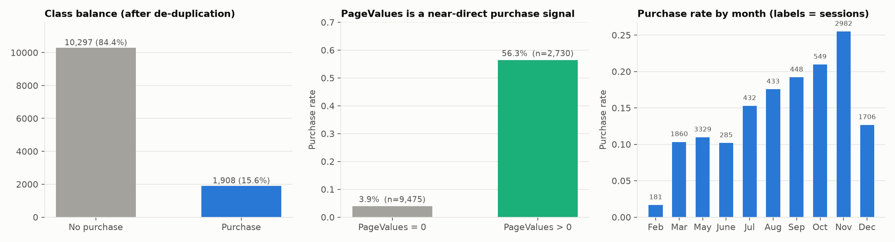
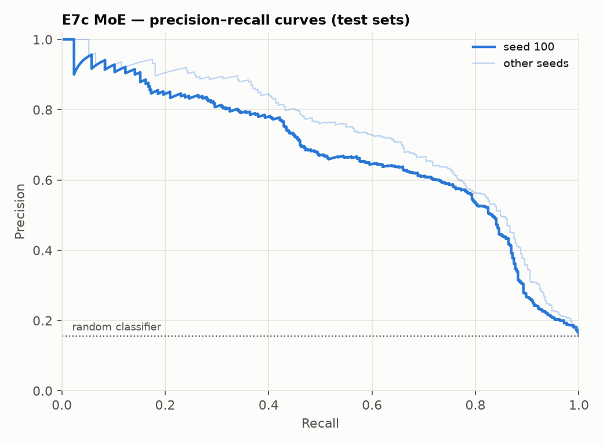
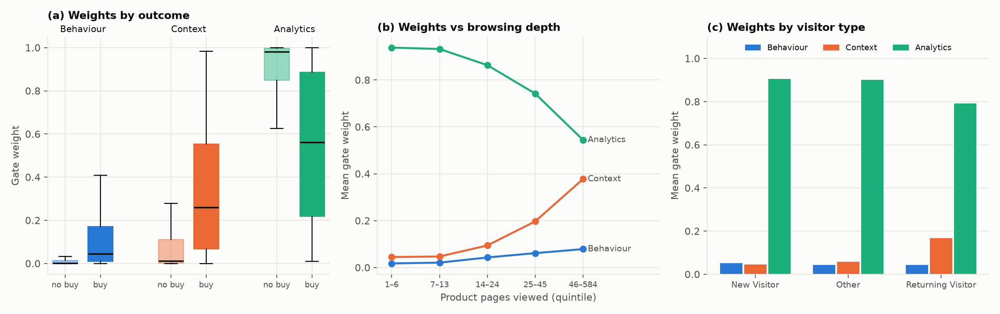

# Context-aware Feature-Group Mixture of Experts for Online Purchase-Intention Prediction

**Course project — Project 3: Online Shopping Behaviour Prediction (binary classification)**

All numbers below come from `results/` and were produced by `run_experiments.py` (10 random seeds, 100–109) and `analyze_results.py`. Mean ± standard deviation is over the 10 seeds; each seed uses a different stratified 80/20 train/test split. Seeds 100–109 were not used at any point while the model was being designed, so these test splits are fresh.

---

## 1. Mathematical Formulation

### 1.1 Problem
Each website session *i* is described by a feature vector **x**ᵢ ∈ 𝒳 (17 raw features: page counts, durations, analytics metrics and visitor context) and a label yᵢ ∈ {0, 1}, where yᵢ = 1 if the session ended in a purchase (`Revenue = True`). Given a training set 𝒟 = {(**x**ᵢ, yᵢ)}ᵢ₌₁ᴺ we want a scoring function

  f : 𝒳 → [0, 1],  f(**x**) ≈ P(y = 1 | **x**)

and a decision rule ŷ = 𝟙[f(**x**) ≥ τ], with threshold τ chosen to balance precision and recall.

### 1.2 Feature-group experts
The input is partitioned into three semantically distinct groups, **x** = (**x**ᴮ, **x**ᶜ, **x**ᴬ):

| Group | Symbol | Features |
|---|---|---|
| Behaviour | **x**ᴮ (6) | Administrative, Administrative_Duration, Informational, Informational_Duration, ProductRelated, ProductRelated_Duration |
| Context | **x**ᶜ (8) | OperatingSystems, Browser, Region, TrafficType, VisitorType, Month, Weekend, SpecialDay |
| Analytics | **x**ᴬ (3) | BounceRates, ExitRates, PageValues |

Each expert j ∈ {B, C, A} is a classifier that sees only its own group:

  Pⱼ(**x**) = P̂(y = 1 | **x**ʲ).

The model type of each expert is matched to its group:

| Expert | Model | Reason |
|---|---|---|
| Behaviour | XGBoost (gradient-boosted trees) | 6 heavy-tailed count/duration features with non-linear effects and interactions |
| Context | XGBoost | 8 mostly categorical features (one-hot) whose effect depends on combinations, e.g. Month × VisitorType |
| Analytics | Logistic regression (log1p + standardise) | only 3 rate features with smooth, near-monotone relationships to purchase |

### 1.3 Adaptive gating network and log-odds pooling
A gating network g_θ maps the full (pre-processed) session representation **z** = φ(**x**) to one weight per expert:

  **s** = W₂ · ReLU(W₁**z** + b₁) + b₂ ∈ ℝ³,  wⱼ(**x**) = exp(sⱼ) / Σₖ exp(sₖ)

so that wⱼ ≥ 0 and Σⱼ wⱼ = 1 **for every session separately**. The experts' opinions are combined in log-odds space:

  f(**x**) = σ( α · Σⱼ wⱼ(**x**) · logit Pⱼ(**x**) + β ),  α = softplus(a) > 0,  β learnable,

where σ is the logistic function and logit p = log(p / (1 − p)).

*Why log-odds instead of averaging probabilities:* a weighted average of probabilities can never be larger than the largest expert probability, so two moderately confident experts cannot *reinforce* each other. Each expert sees only part of the evidence, so evidence should *add up*. Summing log-odds does exactly that (it is the naive-Bayes way of combining independent evidence), while keeping interpretable, per-session, normalised weights wⱼ. Example: two experts at 60 % give 60 % when averaged, but about 69 % when their log-odds are added.

### 1.4 Objective
The experts are trained first. The two XGBoost experts minimise class-weighted logistic loss (positive-class weight = #negatives / #positives, set from each training fold) with L2 leaf regularisation; the logistic-regression expert minimises class-balanced logistic loss with an L2 penalty (C = 1).

The gate parameters θ (and α, β) are then learned by minimising binary cross-entropy on **out-of-fold** expert predictions, with L2 weight decay λ:

  ℒ(θ) = −(1/N) Σᵢ [ yᵢ log f(**x**ᵢ) + (1 − yᵢ) log(1 − f(**x**ᵢ)) ] + λ‖θ‖²

### 1.5 Decision threshold and evaluation target
Because only ~15.6 % of sessions are purchases, accuracy is not the target. The threshold is chosen on training data only:

  τ* = argmax_τ F1( y_train, 𝟙[f_OOF(**x**_train) ≥ τ] )

where f_OOF are out-of-fold predictions. Primary metrics: **F1, precision, recall, PR-AUC**; secondary: ROC-AUC, balanced accuracy, accuracy.

---

## 2. Dataset Overview

**Source.** *Online Shoppers Purchasing Intention Dataset*, UCI Machine Learning Repository (Sakar et al., 2018). Each row is one browsing session on a Turkish online retailer over one year, with each user represented once.

**Motivation.** Most visits to an e-commerce site end without a purchase. Spotting likely buyers early allows targeted offers, live-chat or retention campaigns, and it is a realistic imbalanced-classification problem.

| Property | Value |
|---|---|
| Raw sessions | 12,330 |
| Exact duplicate rows removed | 125 |
| Sessions used | **12,205** |
| Input features | 17 (10 numerical, 7 categorical/binary) |
| Target | `Revenue` (purchase = 1) |
| Purchases / non-purchases | 1,908 / 10,297 (**15.6 % positive**) |
| Missing values | none |
| Train / test per seed | 9,764 / 2,441 (stratified 80/20; 382 buyers in each test set) |

**Important characteristics**

1. **Class imbalance** (15.6 % buyers) → class-weighted experts, F1-optimal threshold, PR-AUC as the main ranking metric.
2. **PageValues is a near-direct purchase signal.** Purchase rate is 56.3 % when PageValues > 0 and 3.9 % when it is 0. It is used as a normal feature, as in the original dataset paper. Note that Google Analytics computes it from pages that *preceded a transaction*, so part of the information may only be known after a purchase (see Limitations).
3. **Categorical IDs stored as integers** (OperatingSystems 8, Browser 13, Region 9, TrafficType 20 levels). They are one-hot encoded, not treated as numbers; levels seen fewer than 30 times in a training fold are merged into an "infrequent" level.
4. **Heavy-tailed durations** (ProductRelated_Duration: median 599 s, max 63,974 s) → log1p + standardisation for the neural gate and the logistic-regression expert (trees need no scaling).
5. **Incomplete calendar**: Month has 10 values; January and April are absent. November (2,998 sessions) has the highest purchase rate.
6. **Duplicates**: 125 identical rows, removed *before* splitting so that copies of the same session cannot appear in both train and test sets.

---

## 3. Methods Used

### 3.1 Leakage-free training protocol (per seed)
1. Stratified 80/20 train/test split. The test set is used only once, for final scoring.
2. 5-fold stratified cross-validation on the training split. **All preprocessing lives inside sklearn pipelines**, so it is refitted on each training fold.
3. Each expert produces out-of-fold (OOF) probabilities for every training session.
4. The gate is trained **only on OOF expert probabilities**, never on predictions made by experts that had seen those sessions.
5. To choose the threshold, the gate itself is cross-fitted on the OOF table (inner 5-fold), giving OOF combined predictions; τ* maximises F1 on them.
6. The experts are refitted on the full training split, and the trained gate is applied to their test-set probabilities.
7. No resampling (SMOTE/oversampling). Imbalance is handled by class weights and the threshold.

### 3.2 Model settings

| Component | Settings |
|---|---|
| Behaviour / Context expert | XGBoost, 400 trees, depth 4, learning rate 0.05, subsample 0.8, colsample 0.8, λ = 1, min_child_weight 2, class-weighted, one-hot categoricals |
| Analytics expert | Logistic regression, log1p + standardised inputs, class-balanced, C = 1 |
| Gate | Linear(d → 16) – ReLU – Linear(16 → 3) – softmax, about 1k parameters |
| Gate training | Full-batch AdamW, learning rate 0.01, weight decay 10⁻³, up to 1,000 epochs, early stopping (patience 50) on a stratified 15 % validation part of the OOF table |

### 3.3 Why these methods suit the problem
* **XGBoost for the Behaviour and Context experts.** Gradient-boosted trees are the usual strongest learner on small tabular data; they capture non-linear effects and interactions inside a group, need no scaling, and handle one-hot categoricals well. Shallow trees, row/column subsampling and L2 regularisation keep them from overfitting ~10k sessions.
* **Logistic regression for the Analytics expert.** Its three features are rates with smooth relationships to purchase, so a linear model on log-scaled inputs is enough, is reasonably calibrated, and gives the gate a stable, low-variance expert.
* **Mixture of Experts** directly encodes the hypothesis that different visitors are best explained by different evidence, and its weights wⱼ(**x**) are interpretable per session.
* **Log-odds pooling** lets complementary experts reinforce each other instead of being averaged down.

---

## 4. Results and Analysis

### 4.1 Main results (test set, mean ± std over 10 seeds)

| Metric | E7c MoE |
|---|---|
| Precision | 0.589 ± 0.031 |
| Recall | 0.756 ± 0.027 |
| **F1** | **0.661 ± 0.012** |
| **PR-AUC** | **0.703 ± 0.019** |
| ROC-AUC | 0.900 ± 0.008 |
| Balanced accuracy | 0.829 ± 0.008 |
| Accuracy | 0.879 ± 0.009 |

Per-seed results (`results/summary_tables.md`) range from F1 0.642 to 0.683, PR-AUC 0.672 to 0.725 and accuracy 0.866 to 0.897. The learned threshold τ* ranges from 0.24 to 0.39, well below 0.5, because buyers are rare.

**What these numbers mean on one test set** (2,441 sessions, 382 buyers; mean over seeds):

| | Predicted buyer | Predicted non-buyer |
|---|---|---|
| **Actual buyer** | 289 (found) | 93 (missed) |
| **Actual non-buyer** | 203 (false alarm) | 1,856 |

The model finds about **3 out of 4 buyers**; about **6 out of 10 flagged sessions** really buy.

**Reference points:**
* Always predicting "no purchase" gives **84.4 % accuracy** but finds no buyers, so the model's 87.9 % accuracy is only a modest gain on that metric. This is why F1 and PR-AUC are the main measures.
* A random scorer has PR-AUC equal to the buyer rate, **0.156**; the model reaches **0.703**.

The precision–recall curves are very similar across all 10 seeds, so the result does not depend on a lucky split.

### 4.2 What did the gate learn?

Mean (± std across sessions) test-set weights, pooled over 10 seeds (`results/gate_weights.md`):

| | w_Behaviour | w_Context | w_Analytics |
|---|---|---|---|
| Non-buyers | 0.039 ± 0.11 | 0.101 ± 0.20 | 0.860 ± 0.25 |
| Buyers | 0.120 ± 0.17 | **0.340 ± 0.29** | 0.541 ± 0.33 |

* **The Analytics expert is trusted most** (0.86 of the weight for non-buyers). It carries PageValues, the strongest single signal.
* **For buyers, the gate shifts weight to the Context expert**, more than three times as much (0.340 vs 0.101). Once a session looks promising on the analytics side, context such as month (November), traffic source and returning-visitor status helps separate converting from non-converting sessions.
* **Weights change with browsing depth (panel b).** For short sessions (1–13 product pages) the Analytics expert gets about 0.93 of the weight. For the longest sessions (47+ pages) this falls to about 0.56 and the Context weight rises to about 0.37. Long sessions all look "engaged", so analytics metrics alone discriminate less, and the visit's context becomes the tie-breaker.
* **Returning visitors** get about three times more Context weight than new visitors (0.154 vs 0.047). Returning visitors have a history, so their context is more informative.
* **The Behaviour expert gets little weight** (≤ 0.12 on average). Its information is largely covered by the other two experts.
* These weights describe how the gate *combines* the experts; they are not causal feature importances.

### 4.3 Errors and observations
* **Precision is the weak side.** About 4 in 10 flagged sessions do not buy. The F1-optimal threshold deliberately trades precision for recall (0.59 vs 0.76); a business that cares more about wasted offers could raise the threshold.
* **Seed-to-seed variation is small** (std 0.012 F1, 0.019 PR-AUC), so the estimates are stable.
* **Fresh splits confirm the estimate.** During development the same model scored F1 0.660 / PR-AUC 0.705 on seeds 0–9; on the unseen seeds 100–109 it scores 0.661 / 0.703. The design choices therefore did not overfit the development splits.

---

## 5. Conclusion

**Main findings**

1. A leakage-free pipeline (dedup → stratified split → in-fold preprocessing → OOF-trained gate → train-only threshold) gives realistic, stable scores for the context-aware MoE: **F1 0.661 ± 0.012, PR-AUC 0.703 ± 0.019, ROC-AUC 0.900, accuracy 87.9 %**, finding about 76 % of buyers with 59 % precision.
2. **The gate learns sensible, interpretable per-session weights.** It relies on the Analytics expert by default and shifts weight to the Context expert for buyers, for very long sessions and for returning visitors.
3. **Log-odds pooling** lets complementary experts reinforce each other, which plain probability averaging cannot.

**Limitations**
* One dataset from one retailer and one year; January and April are missing.
* **PageValues** may be partly known only after a purchase, so the scores may be optimistic for a real-time setting.
* Features summarise the *whole* session, so this is not an early-in-session prediction model.
* Only the main model is reported here, without baselines. In development experiments, a single Random Forest on all features scored higher (about F1 0.68, PR-AUC 0.74), because feature-group experts cannot learn interactions *between* groups; the MoE trades some accuracy for interpretable per-session expert weights.
* The feature grouping and expert model types were chosen by hand.
* The threshold maximises F1 only; a real deployment should weigh the business costs of false positives and false negatives.

**Future improvements**
* **Interaction-aware experts:** give each expert its own group plus a small shared core (for example PageValues and VisitorType), or let the gate also output a residual correction, so cross-group interactions are not lost.
* **Probability calibration** of experts (Platt or isotonic) before pooling, and cost-sensitive thresholds.
* **Gate regularisation** (for example an entropy bonus) so that weights stay smooth rather than collapsing onto one expert.
* **Learned or soft feature groups** instead of hand-made semantic groups, and joint end-to-end training of experts and gate.
* **Sequential / early-session data** (clickstreams) to test a true real-time purchase predictor.

---

### Reproducibility
`python -u run_experiments.py --seeds 10` (seeds 100–109 run in parallel on all CPU cores; under a minute on a 6-core laptop CPU), then `python analyze_results.py`. See [README.md](README.md). Software: Python 3.14, scikit-learn 1.9.1, XGBoost 3.4.1, PyTorch 2.15 (CPU), pandas 3.1.

### Reference
Sakar, C. O., Polat, S. O., Katircioglu, M., & Kastro, Y. (2018). Real-time prediction of online shoppers' purchasing intention using multilayer perceptron and LSTM recurrent neural networks. *Neural Computing and Applications*, 31, 6893–6908. Dataset: UCI Machine Learning Repository, "Online Shoppers Purchasing Intention Dataset".
